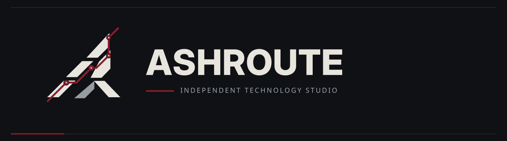

  

<strong>WE BUILD OUR OWN WAY.</strong>

Independent software &amp; experimental technology studio

---

### The work comes first.

ASHROUTE is an independent software studio run by one developer. Before there are products, there has to be a place to build them: a working environment, a visual identity, and a way to keep decisions on record.

Nothing has been released under this name yet. The first project will have a home here when it is ready.

### The approach

If you rely on a system, you should understand what it does — and what it leaves behind.

Choose tools you can understand. Question the defaults. Take responsibility for what you release. That matters more than looking impressive from the outside.

### Areas of interest

`SOFTWARE` &nbsp; / &nbsp; `SYSTEMS` &nbsp; / &nbsp; `AI & AUTOMATION` &nbsp; / &nbsp; `EXPERIMENTS` &nbsp; / &nbsp; `GAMES`

These are directions for future work, not existing departments or released products.

### Current state

**FOUNDATION** — Identity established. GitHub infrastructure in progress. Website planned. No ASHROUTE products released yet.

<strong>Русская версия</strong>

 

### Сначала — дело.

ASHROUTE — независимая студия одного разработчика. Прежде чем выпускать программы, нужно подготовить место, где они будут появляться: рабочую среду, собственный визуальный язык и понятные правила работы.

Под этим именем пока ничего не выпущено. Первому проекту найдётся место здесь, когда он будет готов.

### Подход

Если ты полагаешься на систему, нужно понимать, как она устроена, что делает и какие следы оставляет.

Здесь важнее понимать свои инструменты, сомневаться в настройках «по умолчанию» и отвечать за результат, чем создавать впечатление солидной компании до первой работы.

### Направления

`ПО` &nbsp; / &nbsp; `СИСТЕМЫ` &nbsp; / &nbsp; `ИИ И АВТОМАТИЗАЦИЯ` &nbsp; / &nbsp; `ЭКСПЕРИМЕНТЫ` &nbsp; / &nbsp; `ИГРЫ`

Это направления интереса, а не действующие отделы или выпущенные продукты.

### Сейчас

**ФУНДАМЕНТ** — фирменный стиль утверждён, GitHub-инфраструктура настраивается, сайт запланирован. Собственных релизов ASHROUTE пока нет.

